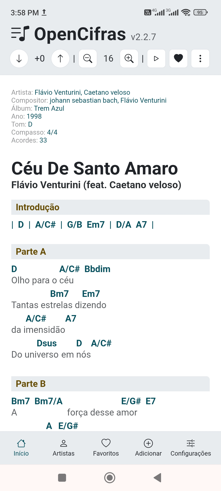
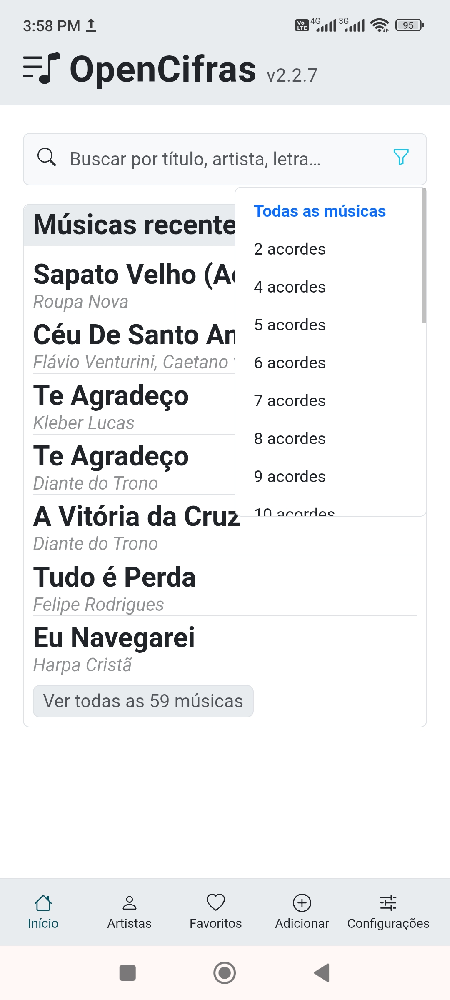
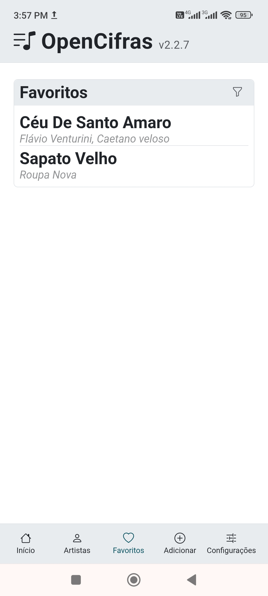
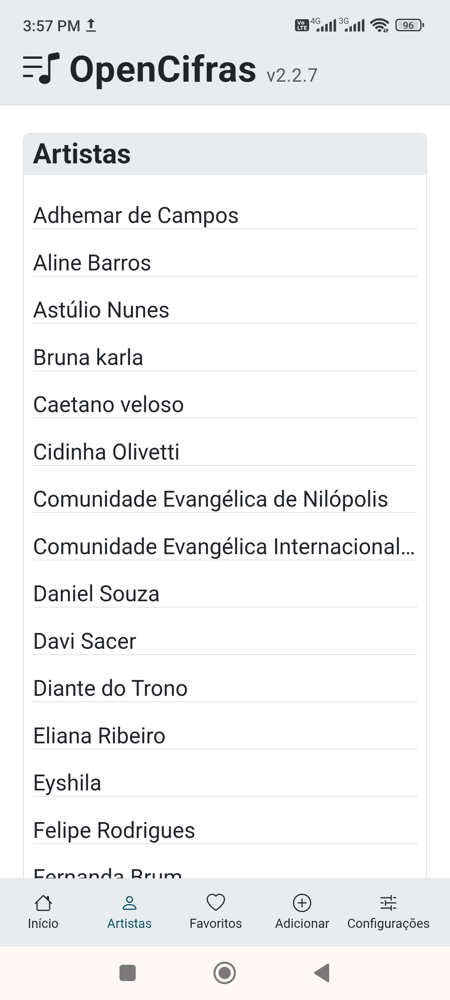
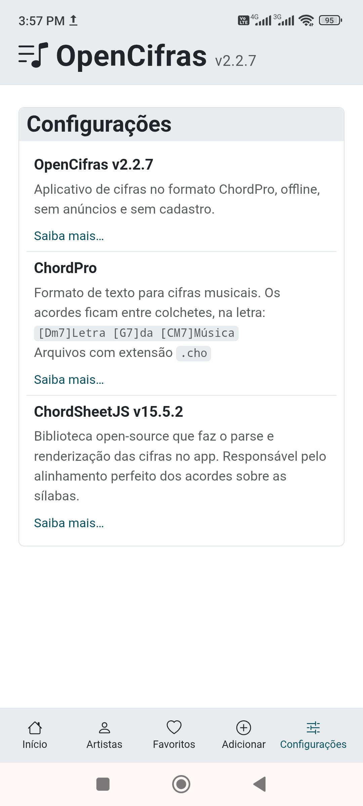

# OpenCifras

O **opencifras** é uma aplicação web (PWA) minimalista, de alta performance e direto ao ponto para gerenciamento, busca e visualização de cifras musicais no formato [**ChordPro**](https://github.com/ChordPro/chordpro). 

Projetado especificamente para músicos de palco e ministérios de louvor, o aplicativo elimina a necessidade de PDFs estáticos ou softwares pesados. Ele combina o poder do formato de colchetes com um ecossistema inteligente de armazenamento local, garantindo cifras dinâmicas, responsivas e que nunca deixam o músico na mão no meio do show.

**Acesse a aplicação rodando no GitHub Pages:** [realsigmamusic.github.io/opencifras](https://realsigmamusic.github.io/opencifras)

|   |   |   |   |   |
|---|---|---|---|---|
|  |  |  |  |  |

---

## Diferenciais

* **Alinhamento Perfeito de Fonte (Sem Quebras):** Ao contrário dos grandes portais de cifras que renderizam o texto de forma rígida em tags `<pre>`, o opencifras processa a cifra estruturalmente em blocos HTML fluidos (`.row`, `.chord`, `.lyrics`) via `ChordSheetJS`. Você pode aumentar ou diminuir a escala da fonte e os acordes permanecem milimetricamente fixados sobre a sílaba correta.
* **Transposer Resiliente com URL Viva:** Mude o tom da música instantaneamente pelos botões de transposição. O tom selecionado é memorizado no dispositivo (por música) e anexado via parâmetro na URL (`?file=...&transpose=...`), facilitando o compartilhamento da cifra no tom exato com os outros integrantes da banda.
* **Busca Avançada com Algoritmo Fuzzy:** Impulsionado pelo `Fuse.js`, a barra de pesquisa executa uma varredura instantânea e profunda cruzando dados de **Título**, **Artista** e trechos da **Letra da música** simultaneamente, ignorando acentos ou erros pequenos de digitação.
* **Filtros Combinados (Dificuldade e Fórmula de Compasso):** O menu de filtro (ícone de funil) permite filtrar as cifras não apenas pela quantidade de acordes distintos (dificuldade), mas também pela **fórmula de compasso/ritmo** da música (como 4/4, 3/4, 6/8, extraídos da tag `{time: ...}` do ChordPro), funcionando perfeitamente tanto na Home quanto nos Favoritos.
* **Rolagem Automática com Velocidade Ajustável:** Botão dedicado na tela da cifra ativa uma rolagem automática, útil para tocar ao vivo sem precisar tocar na tela — ela se interrompe sozinha ao chegar no fim da cifra. Ao ativar, um slider de velocidade aparece (some quando a rolagem é desligada) e permite ajustar a velocidade em tempo real, mesmo com a rolagem já em andamento. A última velocidade escolhida é lembrada no aparelho para a próxima vez.
* **Exportação Multiformato Sob Demanda (PDF, TXT, CHO):** Na tela de visualização da cifra, o músico pode exportar a música em três formatos: o arquivo `.cho` original, a cifra transposta em texto simples `.txt`, ou gerar dinamicamente um arquivo `.pdf` perfeitamente formatado no tom atual de visualização. Para economizar largura de banda e tempo de carregamento inicial, as bibliotecas de geração de PDF (`jsPDF` e o formatador PDF do `ChordSheetJS`) são carregadas sob demanda (lazy loading) apenas ao clicar no botão.
* **Configurações em Modal Não-Bloqueante:** O painel de preferências é apresentado em um modal overlay dinâmico. Isso permite que você altere as configurações a qualquer momento — inclusive diretamente de dentro da tela de leitura de uma cifra — sem recarregar a página e sem perder a sua posição atual de leitura.
* **PWA com Cache Resiliente:** O Service Worker pré-cacheia cada arquivo `.cho` individualmente (não tudo-ou-nada), então uma música com erro de rede não impede as demais de ficarem disponíveis offline.
* **UI Dinâmica e Altamente Personalizável:** Interface limpa construída com variáveis CSS nativas (`:root`). Além do suporte automático a **Modo Claro e Modo Escuro** via sistema, o painel de configurações permite alternar manualmente o tema, selecionar a **família de fontes da cifra** (Sem serifa, Com serifa, Monospaçada — aplicada só ao texto da música, sem alterar a fonte do restante da interface) e escolher uma **cor de destaque personalizada para os acordes** (Azul, Verde, Laranja, Vermelho, Roxo) que se adapta de forma inteligente e dinâmica ao fundo claro ou escuro.
* **Carrossel de Banners Dinâmicos:** A tela inicial apresenta um carrossel de banners deslizante (com autoplay e botão de fechar) para veiculação de anúncios, avisos importantes ou parceiros. Ele é facilmente configurável via arquivo `app.js` sem necessidade de mexer no HTML estrutural.
* **Análise Harmônica (Graus e Inversões):** O autor da cifra escreve a análise dentro do próprio colchete, depois de um `*` (ex.: `[G7*V7]`), e o músico escolhe em **Configurações** como vê-la: **Desligada**, **No lugar dos acordes** ou em uma **Linha extra, abaixo da letra**. A análise é relativa ao tom (não precisa ser transposta) e cifras sem análise continuam funcionando normalmente. Veja a seção [Análise Harmônica](#análise-harmônica).
* **Cifras Próprias (Importar/Criar/Editar):** O botão **+** no menu inferior abre um editor para colar, digitar ou importar um arquivo `.cho` do aparelho. Essas cifras ficam salvas só no `localStorage` do dispositivo e aparecem misturadas ao restante do acervo (busca, Home, artistas, favoritos), com um selo **Local** discreto no card. Também é possível clicar em **Editar cifra** em qualquer música do acervo oficial: o app cria automaticamente uma cópia local editável (sem alterar o arquivo original do repositório) e já abre o editor nela.

---

## Tecnologias e Arquitetura

Focado em simplicidade de deploy, velocidade máxima de carregamento e zero dependência de servidores ativos (Serverless):

* **Vanilla JavaScript (ES6+)** - Sem frameworks complexos (React/Vue), garantindo que o app rode em celulares antigos sem travar.
* **HTML5 & CSS3 Custom Properties** - Layout responsivo, focado em legibilidade de alto contraste sob iluminação de palco.
* **ChordSheetJS** - Motor robusto encarregado de parsear e converter os arquivos `.cho` em HTML responsivo.
* **jsPDF & ChordSheetJS-PDF** - Bibliotecas robustas de geração de PDF carregadas de forma assíncrona/tardia (lazy load), permitindo exportar cifras perfeitas de maneira 100% client-side.
* **Fuse.js** - Mecanismo leve de busca fuzzy local.
* **Service Worker (Cache-First)** - Configurado para cachear instantaneamente a casca estrutural do app (HTML, CSS, JS e Vendors), permitindo inicialização offline imediata.

---

## Como o Catálogo é Alimentado

O acervo de músicas é armazenado em formato de texto puro `.cho` dentro da estrutura do projeto. Para manter a aplicação leve e estática, o índice de busca é centralizado em um arquivo único `songs.json` gerado via automação.

### O Fluxo de Trabalho:
**Build do Catálogo:** Execução do script gerador (`build.js`, Node.js) que varre recursivamente a pasta `songs/`, e para cada `.cho`:
* Extrai os metadados ChordPro (`{title:}`, `{artist:}`, `{time:}` etc.);
* Extrai a letra limpa (sem acordes) para indexação pelo `Fuse.js`;
* Conta os **acordes únicos/distintos** da música (`chordCount`), usado no filtro por dificuldade;
* Carimba o timestamp de modificação (`mtime`, usado na seção de Recentes).

O resultado é escrito em `songs.json`, consumido pelo app no navegador.

#### rode o build
```bash
npm run build
```

> Sempre que adicionar, editar ou remover uma cifra em `songs/` (ou mexer na análise harmônica), rode `npm run build` para regenerar o `songs.json`. 
>
> `npm run build` é um atalho para `node build.js`; não precisa de `npm install`, pois o script só usa módulos nativos do Node.js.

### Cifras Locais (do usuário)

Além do acervo oficial em `songs.json`, o app mantém no navegador um segundo catálogo, **por aparelho**, com as cifras que o próprio usuário importou ou criou (`assets/js/local-songs.js`, salvo em `localStorage`). Em tempo de execução os dois catálogos são unidos numa única lista (busca, Home, artistas e favoritos enxergam tudo junto), e cada cifra local ganha um "arquivo" sintético no formato `local:<id>` para se comportar como qualquer outra música do acervo. Nada disso passa pelo `build.js` nem é publicado no GitHub Pages — é conteúdo que existe só localmente, no aparelho de quem o criou.

---

## Análise Harmônica

O recurso mostra o **grau** de cada acorde (algarismos romanos, inversões e dominantes secundários) sem alterar o acorde nem a transposição. A análise vai dentro do colchete, depois de um `*`:

```
[C*I]Eu canto [G7*V7]a ti, [C/E*I6]Senhor
```

Um pré-processador (`assets/js/analysis.js`) separa a análise do acorde **antes** de o texto chegar ao ChordSheetJS, que só vê `[G7]` e transpõe normalmente. A análise é guardada à parte, por ordem de colchete.

### Modos de exibição (Configurações → Análise harmônica)

* **Desligada:** só os acordes (padrão).
* **No lugar dos acordes:** a análise substitui o acorde. Acordes sem análise continuam visíveis em cor apagada, para o layout não "pular" ao alternar.
* **Linha extra, abaixo da letra:** acorde, letra e, por último, a análise.

A preferência vale para todas as músicas e fica salva no aparelho. O modo só atua em cifras que tenham ao menos uma análise.

### Sintaxe

Estrutura, nesta ordem: `acidente?` `numeral` `qualidade?` `figurado?` `/alvo?`. Exemplo completo: `bvii` + `o` + `7` + `/V`.

| Parte | Digitação | Aparece como |
|---|---|---|
| Acidente | `b` · `#` | ♭ · ♯ |
| Numeral maior / menor | `I`…`VII` / `i`…`vii` (a caixa é significativa) | I…VII / i…vii |
| Qualidade | `o` (diminuto) · `h` (meio-diminuto) · `+` (aumentado) | ° · ø · ⁺ |
| Figurado | `7` · `6` · `M7` | ⁷ · ⁶ · ᴹ⁷ |
| Figurado (inversões) | `6,4` · `6,5` · `4,3` · `4,2` | dois números empilhados |
| Alvo (dominante secundário) | `/` + numeral, com acidente opcional | `V7/IV` → V⁷/IV |

Exemplos: `I`, `ii7`, `V7`, `IM7`, `I6,4`, `V4,2`, `V7/IV`, `viio7/V`, `bVII`, `iih7`, `V+`.

### Regras importantes

* O lado esquerdo do `*` precisa ser um acorde (começar com nota de A a G). Marcadores como `[|]`, `[%]`, `[N.C.]` e a anotação oficial do ChordPro `[*I]` não são tocados.
* Análise vazia (`[C*]`) é ignorada em silêncio.
* Análise com erro de sintaxe **nunca quebra a tela**: o acorde funciona normalmente e, no modo de análise, o texto cru aparece com destaque de aviso.
* Depois do parse, o app confere se o número de colchetes bate com o de pares com acorde. Se não bater, o modo de análise se desliga sozinho para aquela música, em vez de mostrar a análise no acorde errado.
* Os símbolos (♭ ♯ ° ø ⁺) são caracteres de texto reais, para a exportação em PNG funcionar.
* A análise **não** é incluída nas exportações `.txt` e `.pdf`; o `.cho` exportado mantém o texto original, análise inclusa.
* No escopo atual: um tom por música, sem modulação nem acorde pivô. Rótulo de tonalidade, napolitana, sextas aumentadas e extensões de cifra (9, 11, 13, sus4, add9) ficam para depois.

---

## Organização do Projeto

* `index.html`: Ponto de entrada único do aplicativo (SPA). Alterna entre a Home (busca, artistas, favoritos) e a tela da cifra via parâmetro `?file=` na URL, sem recarregar a página. Contém também o editor de cifras (`#cho-editor-overlay`) e o novo modal dinâmico de configurações (`#settings-overlay`).
* `build.js`: Script Node.js que varre `songs/`, faz o parse dos arquivos `.cho` e gera o `songs.json`. Rode com `npm run build`. Remove a análise harmônica do texto antes de contar acordes e extrair a letra.
* `assets/js/analysis.js`: Pré-processador e renderizador da análise harmônica (módulo UMD, usado no navegador e no Node). Separa `[G7*V7]` em acorde + análise, valida a sintaxe e gera o HTML dos símbolos. Compartilhado por `song.js`, `local-songs.js` e `build.js`.
* `sw.js`: Service worker focado no isolamento e persistência offline dos assets e das cifras.
* `songs.json`: Índice estruturado de metadados de todo o acervo oficial (título, artista, time/compasso, letra, `chordCount`, `mtime`), gerado pelo `build.js`.
* `assets/js/local-songs.js`: Camada de armazenamento das cifras locais (`localStorage`) — ler, salvar, excluir e converter uma cifra local no mesmo formato de catálogo usado pelas músicas do `songs.json`. Compartilhada entre `app.js` e `song.js`.
* `assets/js/app.js`: Inteligência da tela inicial — busca fuzzy, filtros combinados (acordes e fórmula de compasso), favoritos, listagem de artistas, carrossel de banners da Home, e o gerenciador global de preferências (tema, fonte da cifra, cor dos acordes) integrado ao modal de configurações.
* `assets/js/song.js`: Motor de renderização da cifra — transposição resiliente com atualização da URL, ajuste de escala da fonte, download da cifra nos formatos `.cho`, `.txt` (transposta) e `.pdf` (geração client-side assíncrona sob demanda), rolagem automática com controle de velocidade (slider que aparece só enquanto a rolagem está ativa), botão **Editar cifra**, e os modos de exibição da análise harmônica (no lugar dos acordes ou em linha extra).
* `assets/css/`: Folhas de estilo divididas (`style.css` para a estrutura global, componentes de UI, carrossel de banners e modais; `song.css` para o comportamento e design visual dos acordes).
* `songs/`: Acervo de cifras em texto puro, no formato `.cho` (ChordPro).

---

## Execução Local

> Alterou cifras em `songs/`? Rode `npm run build` antes de testar ou publicar.

Como o projeto faz requisições locais (`Fetch API`) para carregar o `songs.json` e os arquivos `.cho`, o navegador bloqueará o funcionamento se você abrir o `index.html` clicando duas vezes (Erro de CORS). É necessário rodar um servidor local simples:

### Usando Python
```bash
python -m http.server 8000
```

Acesse `http://localhost:8000`

### Usando o Node.js
```bash
npx http-server .
```

### Usando o VS Code / Code OSS

Instale a extensão **Live Server**, clique com o botão direito no `index.html` e selecione **"Open with Live Server"**.

---

## Licença

Este projeto está sob a licença **MIT**. Sinta-se livre para usar, clonar e adaptar para a sua banda ou igreja.